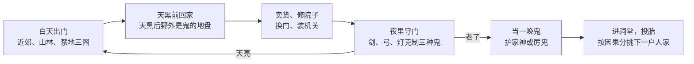
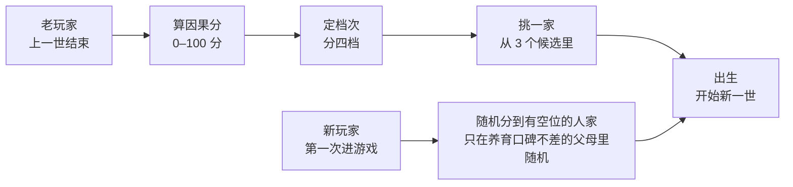
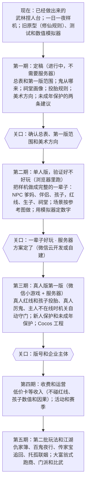

# 武林世家 · 路线图（v4）

2026-11-16（11-20 更新）

这一版是重写：最前面的总表说清楚「已定、待定、点子池」，后面是细节。这份 Markdown 是在线路线图文档的副本，内容一样；在线版只有产品负责人的账号能打开，改了一边要同步另一边。

## 一句话

武侠版「一辈子」：你出生在真人玩家爹妈的家里，现实里只活 1–2 周。白天出门找东西，晚上守住家门；老死以后当一晚鬼，然后投胎。**砸你家门的鬼，是别人家的祖宗。**

**玩法的两把尺子**：一，玩家觉得爽；二，自由度尽可能高。每个玩法都拿这两条来验收。

## 总表

### ✅ 已定

| 方面 | 定了什么 |
| --- | --- |
| 题材 | 武侠。不做修仙；戏曲不进人物形象 |
| 玩家是谁 | 孩子就是真人玩家（参考《一小时人生》），生在一对玩家爹妈家里；一辈子约现实 1–2 周 |
| 第一版核心循环 | 一天一夜：白天出门、天黑前回家 → 卖货、修院子 → 夜里守门，门破了真丢东西 → 老死当一晚鬼 → 投胎 |
| 鬼从哪来 | 大部分是电脑鬼，保证每晚都有得打；死去的真人玩家是少见的「厉鬼」精英：带名字、更强、能抢宝物 |
| 祠堂 | 一个玩家死了，他捏的脸画进家里的祖宗画像，一代代传下去 |
| 红线和孩子 | 爹妈红线越浓，孩子品级越好；一辈子内最多到挚爱，金缕要三生三世重逢 |
| 出生差距 | 品级主要给面子（称号、光环、祠堂画框），强弱最多差三成：孩子是别人投胎来的新玩家，不能让陌生人的感情决定他弱好几倍 |
| 成家两条路 | 牵红线生孩子，或者收徒弟。不想谈恋爱也能有后人；有后人就能投胎回自己家 |
| 好友投奔 | 好友点分享链接，就能生在你家或者拜你为师 |
| 时间模型 | 一个现实日 = 一天一夜。白天能花的是时辰，花完就天黑；什么时候玩由玩家定，不跟现实的钟走。**攒天**：没用完的天能攒起来，最多攒 3 天，可以连着过（2026-11-19 定） |
| 真人互动 | 第一版全部异步：真人厉鬼打你家的机关，结伴和驰援借好友的人当电脑帮手，野外掉的东西一直留着 |
| 定位 | **人会老死，家会留下来**：院子、祠堂、做过的东西一直在；下一世回来，看到的是自己留下的家（11-20 定） |
| 不在线时 | 鬼照样会来砸门，只靠机关自动守；**最多丢一点钱，不丢宝物，不伤人**（11-20 定）。丢多少：门破了丢家里钱箱的一成，**最多 20 文**；离开一段时间最多丢一次 |
| 进入游戏的节奏 | 每次进来都有反馈（离开后发生了什么）；1–3 分钟能收获一点，5–10 分钟能做完一件事，想玩久也有得玩（11-20 定） |
| 守夜不是通行证 | 装饰、经营这些事不用先守夜才能做；不想自己打的晚上，也可以交给机关守，结果和不在线一样（11-20 定） |
| 交给机关守的晚上 | 机关守住了，**算守住一夜，但因果分只给一半**：亲手守还是更值（11-20 定） |
| 交给机关守怎么算 | **不让机关真的打一遍，看家底算把握**：每晚的鬼有强度，天数越往后越强；门越好、机关越多，防守分越高。两个一比算出「守住的把握」，**开打前就告诉玩家**（例如「今晚交给机关守：守住的把握 七成」）。修院子时也能看到装上以后把握涨多少（11-22 定） |
| 不在线和交给机关的细则 | ① 不在线的日子**不长年纪、不花攒天**；机关守住给半份因果，没守住不扣。② **整个第一世**不在线、交给机关守都不丢钱。③ 第 1 晚也能交给机关，两个选择一模一样，不劝。④ 攒天用完时**只能看不能动**：能看战报、家人、祠堂、院子，不能买卖、修院子、出门。⑤ 交给机关守住也有纸钱，大约是亲手守的一半（11-22 定） |
| 打到一半离开 | 白天或守夜打到一半离开：**当天回来就接着打**；隔了一天才回来，那一晚就当交给机关守了（11-20 定） |
| 家里的东西归谁 | **归「家」，不归哪一个人**：钱箱、仓库、院子、门、机关、宝物、祠堂，活着的家人一起用。你老死时，还活着的后人接着用；你投胎回来，是回到还在用这些东西的家里，**钱和货一文不少**（11-20 定） |
| 两个口袋 | **家里的钱箱**：放进去就是全家的，**只能花在家上**（修门、机关、扩院子、装饰）。**自己的钱袋**：白天自己挣的，买自己的东西（兵器、衣服、草药），也能放进钱箱帮家里。人老死了，钱袋里剩的钱自动进钱箱。这样孩子就算是陌生人投胎来的，也掏不空家里（11-20 定） |
| 两个口袋的细则 | ① **谁背回来就是谁的**：背回家的东西卖了，钱进自己的钱袋；放进仓库才归家，仓库里的东西卖了钱进钱箱。② **门破了随机抢**：钱袋随机抢走两到四成，钱箱锁着只抢零到两成，宝物照旧随机丢一件；抢多少开打前就定好，刷新不重抽。③ **看东西最后落在哪**：花完东西留在家里的（修门、机关、扩院子、装饰、收徒弟），钱箱钱袋都能用；东西到了某个人手里的（送礼物、买兵器），只能用钱袋（11-21 定）。④ **不管怎么走的，家里的东西都留给家**：独自在禁地早逝也一样，钱袋进钱箱、院里的个人东西进仓库；只有当时背在身上的背包掉在原地（11-22 定） |
| 没有后人时 | **宅子不消失**：院子长草、门变旧，东西和祠堂画像都还在（11-20 定）。以后谁能住进去，见点子池 |
| 祖传的机关 | 回自家投胎的第一天，家里已经有的机关**照常工作**；带路只是先把「买」的入口藏起来（11-20 定） |
| 投胎 | 老玩家按因果分从 3 户人家里挑，有后人时第一个选项是回自己家；新玩家随机分到有空位、口碑不差的人家 |
| 能力 | 没有职业，只有根骨、悟性、身法、心性四项；打法看手里拿的东西和当晚挑的本事，随时换 |
| 打鬼 | 鬼头上只写特点（飞、隐、甲），不给答案；每个特点都有好几种解法。守住一波挑一个本事 |
| 鬼跟着工具一起来 | 手里只有剑的晚上（带路的第一天），**只来普通鬼**，门会掉一点血但守得住；弓、灯、机关开放以后，飞、隐、甲才出现。不开带路的照常来（11-21 定） |
| 交情 | 靠做过的事攒；第一版做结伴和驰援 |
| 人物 | 半 Q（3–4 头身），玩家自己捏，自由度最高；捏脸分两层（先选部件，微调收起）；性格和声音不影响数值 |
| 场景 | 我们来定；方向是白天暖、夜里只有灯、阴间是雾和水 |
| 未成年保护 | 只做时段限制，加上法律硬性要求的实名和付费限制 |

### ⏳ 待定

| 事情 | 现在的状态 |
| --- | --- |
| 未成年保护的两条建议 | 等产品负责人决定（见「未成年保护」） |
| 场景参考图怎么用进游戏 | 美术的下一步（见「美术方向」） |
| 夜里暗到什么程度 | 先搁置，等场景一起定 |
| 金缕门槛、因果分各项数字、守夜难度 | 第二期用模拟器定 |
| 声音方案 | 以后再做；样机里的浏览器朗读只是占位 |
| 鬼挤在门口时图标叠在一起 | 样机里再改 |
| 白天改成能走动、能动手的一小片（河边） | **正在试**：先做家门口到河边一小片，看玩家会不会过出跟原计划不一样的一天（`docs/RIVERSIDE_SLICE_SPEC.md`） |
| 新玩家不知道下一步做什么 | **正在做**：带路（今天的念头、一天一天开放、祖宗带路），见 `docs/GUIDANCE_SPEC.md` |
| 把样机的规则搬进 `src/core/loop` | **第一、二阶段做完了**：时间、野外、五波守夜进了规则核心（11-21，`docs/STAGE1_REPORT.md`）；第一晚只来普通鬼（11-21）；存档分成家和人、两个口袋、一晚只结算一次（11-22，`docs/qa/stage2/README.md`）。存档、口袋和结算的规则只写在核心里一份，打包成 `assets/loop-core.js` 给样机用。**正在做**：第三阶段，交给机关守（看家底算把握）、不在线的晚上、回来时的摘要（`docs/STAGE3_SPEC.md`） |
| 亲手守输了，比交给机关守亏得多 | 亲手守门破了丢钱袋两到四成、钱箱零到两成和一件宝物；交给机关最多丢 20 文。难的晚上玩家可能都不敢自己打；守夜打到一半关掉游戏、隔天回来就变成交给机关，也是个漏洞。**先不管（11-22 定）**：等真机试玩，看大家是不是真的都交给机关、有没有人靠关游戏逃，看完再定。守夜中途「撑不住了交给机关」的按钮不要（11-22） |
| 经营只有一条直线（采 → 卖 → 买门） | 带路做完以后先试一小块：三种赚钱（直接卖、加工、接委托）、四种花钱（守门、扩院子、装饰、家人）、每天行情上下两成；加工「过一夜就好」，不另开现实时间的钟 |
| 表情库开局给哪些、怎么解锁；手绘图案怎么审核 | 第二期 |
| 「生孩子」怎么说 | 师徒这条路已经让任何人都能有后人；红线这边的说法还待定 |
| 版号和企业主体 | 收费上线前要有 |

### 💡 点子池（先不做）

- **第二批**：仇家簿（谁砸破过你家门，死后可以指定去报仇，恩和仇都能传代）、传家宝被抢后能追回、百鬼夜行（每周一晚，鬼群攻全服最强的大宅，守住或被破都全服通报）、捉鬼进葫芦、托孤、联姻、最佳爹妈和最佳小孩通报
- 院子里的树跟着你的年纪变：小时候开花，老了落叶
- 奈何桥改成提着灯坐船过河
- 守夜的更多随身物：笛子、伞、葫芦、扇子
- 以后再说：作恶越多鬼越凶、投胎越差
- 没有后人的老宅，以后谁能住进去：远房亲戚、新玩家、好友投奔？（11-20 记下）
- 第五期：大富翁式跑商、多人地图、门派和比武

## 三层：一天、一辈子、好几辈子

1. **一天**（第一版的核心）：白天出门，天黑前回家 → 卖货、修院子 → 夜里守门
2. **一辈子**：出生（爹妈的红线决定底子）→ 童年、成年、老年 → 结红线、生孩子（孩子也是真人玩家）→ 老死 → 当一晚鬼
3. **好几辈子**：按因果分投胎 → 交情传下去 → 金缕要三生三世重逢 → 祠堂墙越来越满

## 一天一夜（第一版）

1. **白天出门，天黑前回家**：地图从院子往外分三圈：近郊（安全、东西普通）、山林（有野兽、东西好）、禁地（很危险、有稀有宝物）。走得越远赚得越多，但越可能赶不回来。可以约交情好的邻居结伴。
2. **在野外倒下**：背包里的东西掉在原地，别人能捡；人受重伤，被人扛回家或自己爬回去。只有一个人倒在禁地里才可能丢命（一辈子只有 1–2 周，野外随便死太狠）。
3. **卖货、修院子**：带回来的东西拿去集市卖，钱用来换门、装机关（弩机、灯笼串、镇宅符）。院子越修越气派，别人路过都能看到。
4. **夜里守门**：样机里一晚 5 波，每守住一波从三个本事里挑一个。门的大血条在最上面，鬼头上有小血条和它的特点（飞、隐、甲），不写该用什么。手里拿什么随时换，每个特点都有好几种解法。交情够的邻居可以喊来帮忙。自己守的时候门破了，鬼会随机抢走钱袋两到四成、钱箱零到两成，再加一件宝物；不在线或交给机关守的晚上，最多丢一点钱（钱箱的一成，最多 20 文），不丢宝物。
5. **鬼从哪来**：大部分是电脑鬼，保证每晚都有得打。死去的真人玩家是少见的「厉鬼」精英：头上带名字，更强，能抢宝物。真人玩家一辈子 1–2 周，每天只有很少的人刚死，不够每家每晚都有。
6. **老死以后**：鬼的样子就是你捏的那张脸（发白、腰以下淡掉、飘着）。投胎前二选一：回自家当护家神帮子孙守一夜，或者当厉鬼去砸别人家的门（抢到的东西带进下一世，被捉住扣因果分）。然后你被画进家里的祖宗画像，去奈何桥投胎。
7. **交情**：靠一起出门、帮着守门、送东西攒起来，加好友不算。交情 20 能结伴（更安全、多背 3 件、倒下有人扛你回家），40 能驰援（夜里被砸门时能喊来一起守，每晚一次）。

**保底（不是卖点，但必须有）**：主人不在线时院子靠机关自动守，最多丢一点钱（钱箱的一成，最多 20 文），不丢宝物；门被砸破后有一段保护时间；新家族有新手保护期；孩子给爹妈的评价只影响新孩子优先分给谁，不让好评家族无限多生，新夫妻保底先分到第一个孩子。

### 时间和真人互动

- **一个现实日 = 游戏里的一天一夜。** 年纪一天长好几岁，一辈子大约 11 个一天一夜。
- **攒天**：每个现实日给 1 天，没用完的最多攒 3 天，可以连着过。新玩家开局就有 3 天。这样玩得上头时能多玩一会儿，一辈子又不会一晚上过完（孩子是别的真人玩家，要给他们时间上线）。
- **白天能花的是时辰**（样机里 6 个时辰）。走路、采集、陪伴家人都花时辰，花完天就黑。时间只跟着你的行动走，不跟现实的钟走，所以晚上下班再玩也是从早上开始。
- **守夜什么时候打由你定**；不上线的话，到了第二天由机关自动守，结果第二天告诉你。打到一半离开，当天回来接着打；隔了一天才回来，那一晚就当交给机关守了。
- **第一版所有真人之间的互动都是异步的**，不用约时间：
  - 真人厉鬼打的是你家的机关（像《部落冲突》）；你上线时打的鬼都是电脑鬼
  - 结伴、驰援是借好友捏的人来当电脑帮手
  - 野外掉的东西一直留着，等人来捡
  - 爹妈和孩子之间留东西、留话
- 代价是少一点「大家同时在场」的感觉；换来的是玩家不用约时间，服务器第一版用微信云开发大概就够。实时一起守夜以后再加。

### 家怎么组成

- **两条路都能有后人**：牵红线、红线到知己以后生孩子；或者收徒弟。武侠里师徒和父子一样重。
- 一下子解决了几件事：不想在游戏里谈恋爱的人也能有后人；任何性别组合都能有后人；未成年人可以拜师，不用碰恋爱。
- **好友投奔**：好友点你的分享链接，就能生在你家或者拜你为师。好友分享是微信小游戏最主要的拉新方式之一。
- **有后人，就能投胎回自己家**：做你孩子或徒弟的孩子，院子、机关、宝物、仓里的货和钱都还在，祠堂里挂着前几世的你。如果后人还活着，你们一起用同一个家。没有后人，宅子也不会消失：院子长草、门变旧，东西和画像都还在。
- 一家人夜里会帮着守门。

**样机**：`docs/proto/loop/index.html`（一日一夜）把上面这些串起来能玩，包括结缘、孩子、徒弟、投胎回自家、祠堂；守夜每波挑本事，别的玩家都用电脑代替，数字是占位。用模拟器调过难度：第 1 天当新手教学；第 5 天还是柴门基本守不住，换铁皮门加两台弩机能守住但很紧张；只拿剑不换东西也能赢，但要挑对本事，说明「方法放开」起作用了。

## 一辈子

每个角色都挂在一张关系网上：往上是父母，父母的红线决定你的起点；往旁是伴侣，往下是孩子，你和伴侣的红线决定孩子的起点。父母、伴侣、孩子都是真人玩家，没人来的位置先由 NPC 占着。

一辈子约现实 1–2 周。分段草稿（约 11 天）：童年 1 天，父母照顾；少年 2 天，学武、帮家里干活；成年约 6 天，结缘、生子、经营、守夜；老年 2 天，指点晚辈、结算因果。样机里一辈子是 5 天，只为试玩方便。

红线跨世：一辈子之内最多走到「挚爱」；「金缕」只能靠跨世重逢修成，而且门槛更高。草稿：连续三世重逢，每一世都走到挚爱，第三世才能化作金缕（三生三世）。中间有一世没重逢，连续次数就从头算。所以「天纵」品级的孩子很稀少。

怎么重逢：先走的人可以在奈何桥等对方，最多 2 天，等的时候能看自己的后代、给他们留点东西；等到了就一起投胎。不想等就直接投胎，新的一世里凭「前世印记」相认、重新牵线。重逢必须双方都愿意：一方不想再续前缘，就不会被找到（延续「拉黑零代价」）。

## 投胎

老玩家走完一世，系统把这一世的贡献换算成因果分（0–100），按分数定档次，给 3 个候选家庭让他挑；新玩家随机分家。数字都是草稿，第二期用模拟器校准。

因果分怎么来（每项有上限，刷一样刷不满）：

| 来源 | 怎么算 | 上限 |
| --- | --- | --- |
| 养育 | 投胎来的真人孩子养到成年，每个加分；孩子成年时越强加得越多 | 40 |
| 红线 | 这一世走到的最高等级：知己 5、倾心 15、挚爱 25；和前世伴侣重逢再加 5 | 30 |
| 家业 | 守住的夜、赚的钱，按比例折算；门被砸破扣一点 | 20 |
| 江湖 | 交情、帮邻居守门、当护家神守住 | 10 |
| 负面 | 坑新人、被举报骚扰或诈骗属实、当厉鬼被收进葫芦，每次扣分 | 最多扣 30 |

档次和下一世的条件：

| 因果分 | 档次 | 3 个候选家庭里 | 出生 buff |
| --- | --- | --- | --- |
| 80–100 | 大功德 | 至少 1 家红线到挚爱；自己后代家有空位时一定出现 | 资质 +10% |
| 50–79 | 福泽深厚 | 至少 1 家红线到倾心 | 资质 +6% |
| 20–49 | 小有福报 | 至少 1 家红线到知己 | 资质 +3% |
| 0–19 | 平凡 | 随机 3 家 | 无 |

护栏：

- 只看上一世，不累加：老玩家不会一世比一世滚得更强
- buff 很小（资质最多 +10%）：新玩家不会被碾压，老玩家的优势主要是「挑人家」
- 不上线不扣分；分手、剪线、拉黑不扣分
- 防小号：养育分只算不同真人账号、成年后还在玩的孩子
- 重逢的两个人同时投胎、生在不同两家（不能生在对方家，免得成了兄弟姐妹），候选家庭在同一片地方，方便长大后相认
- 新玩家的「随机」只在有空位、养育口碑不差的人家里随机，防止一进来就碰上坑人的父母
- 交情深（40 以上）的邻居下一世还记得你，交情留一半

## 人：捏人和能力

能让玩家自己选的，就不替玩家定。数值只做「基础能力的高低」，不做限制玩法的职业。

| 方面 | 怎么放开 |
| --- | --- |
| 外观 | 人物全部交给玩家捏（参考《Tomodachi Life: Living the Dream》）：部件、比例、所有颜色；每个五官都能上下、间距、大小、旋转、压扁拉长；痣可以放在任意位置；五官、面饰、衣服花纹、胸前图案都可以自己用手画。捏脸分两层：先选部件和颜色，位置大小这些微调默认收起 |
| 表情 | 不是几张固定的脸，而是一个表情动作库：开局十几个，玩下去解锁更多，随时能用（参考《动物森友会》的「反应」）；还能自己用手画整张脸的表情 |
| 能力 | 没有职业，只有根骨、悟性、身法、心性四项基础能力，出生时由红线决定 |
| 性格和声音 | 性格 5 个滑块各 8 档、16 种；声音调音高和语速。只影响说话和小动作，不影响数值 |
| 守夜 | 怎么出手看手里拿的东西，随时能换。第一版：剑、弓、灯 |
| 关系 | 不限对象数量；随时可以剪线、拉黑 |
| 性别 | 所有部件、玩法都不分性别 |

自己画的图案要配举报和审核，防止不合规的内容。

孩子一出生数值就定了，由三样东西决定：父母的红线越浓，品级越好（品级主要给面子，强弱最多差三成）；父母自己强的方面，孩子也更可能强；投胎来的玩家还带着自己前世的 buff。下面的数字是占位，等模拟器校准。

| 出生时的红线等级 | 孩子品级 | 强弱（草稿） | 面子 |
| --- | --- | --- | --- |
| 金缕 | 天纵 | ×1.3 | 称号、光环、金色祠堂画框 |
| 挚爱 | 奇才 | ×1.2 | 称号、光环 |
| 倾心 | 上等 | ×1.1 | 称号 |
| 知己 | 良才 | ×1.05 | — |
| 相识 | 寻常 | ×1 | — |
| 收徒 | 看师父守住了几夜 | ×1 到 ×1.1 | — |

总资质分到四项属性上（草稿）：

- **根骨**：血量、抗打，守夜时站得住
- **悟性**：学武快，升级便宜
- **身法**：出手快，走得快
- **心性**：做生意，卖货价钱好

怎么分：一半按父母各自最强的属性倾斜，另一半随机，所以同一对父母的孩子各不相同。防止滚雪球：单人和新玩家有收养的孩子保底；红线孩子的上限、多对象时的惩罚，沿用现在的规则。

## 美术方向

总原则：人物是玩家捏的半 Q 小人，场景安静、潮湿、有光。**白天暖、亮、有烟火气；夜里黑，只有灯照到的地方看得清；阴间是雾和水，颜色很淡。** 不做写实：微信小游戏的包体和低端机都撑不住。氛围靠五样在 2D 里很便宜的东西：低饱和的调色、几层雾、单一光源（整个画面压暗，只有灯照到的地方亮）、水面倒影、飘落的粒子（花瓣、雨、萤火、落叶）。

画面要为玩法服务：灯就是安全（守夜时只有灯照到的地方看得清，隐身鬼要拿灯照）；雾就是未知（走得越远雾越浓，禁地藏在雾里）；水是阴阳之隔（奈何桥、投胎）。鬼头上的图标、血条、门的血条永远最醒目，叠在最上层。

**场景参考图怎么用进游戏**（16 张参考图，只作参考，不描）：

| 参考图里的东西 | 用在哪 |
| --- | --- |
| 雨巷里的红灯笼 | 守夜（样机已经试过） |
| 江南水道、乌篷船、临水老房子 | 白天的街市（卖货） |
| 月洞门、亭子、回廊、园林 | 自家院子；院子升级后的样子 |
| 雾里的山、雪坡上骑马、漓江山水 | 野外远景；走得越远雾越浓 |
| 碧绿的湖、黄叶下的石拱桥和倒影 | 野外的采集地点 |
| 梅花、樱花、黄叶、深绿的林子 | 季节；院子里的树跟着年纪变（点子池） |
| 船头的马灯、夕阳下的水面 | 奈何桥和投胎（点子池：坐船过河） |
| 一整面墙的祖宗画像 | 祠堂 |

色调：白天以暖米、黛灰、朱红为主；夜里以青黛、灯笼红、月白为主；阴间以淡紫、雾白为主。界面用宣纸底、木牌、印章点缀，但不压过按钮的清晰度。

鬼的画法：就是玩家捏的那张脸，颜色发白、腰以下淡掉、飘着，自己发一点冷光；电脑鬼用随机捏的脸。不做恐怖。

人物（半 Q，3–4 头身）：所有部件画在同一个基础身体上，灰度图 + 调色盘染色，骨骼动画换部件；所有部件所有性别都能用。开服大约 80 件：

| 部件 | 开服款数 | 可调色 | 举例 |
| --- | --- | --- | --- |
| 体型 | 2 | 肤色 | 偏瘦、偏壮 |
| 脸型 | 4 | 肤色 | 圆、鹅蛋、方、尖 |
| 眼睛 | 8 | 瞳色 | 圆眼、丹凤眼、眉眼带笑…… |
| 眉毛 | 6 | 发色 | 剑眉、柳叶眉…… |
| 嘴 | 6 | — | 表情不画死：五官每个部件画几个状态，和眉毛角度、小特效组合出几十个表情 |
| 前发 | 8 | 发色 | 齐刘海、中分、碎发…… |
| 后发 | 8 | 发色 | 高马尾、双髻、披发、短发…… |
| 发饰 | 6 | 镶边色 | 发带、簪子、斗笠…… |
| 上衣 | 8 | 衣色 + 镶边 | 劲装、长衫、短褂、披风…… |
| 下装 | 4 | 衣色 | 长裤、裙、绑腿…… |
| 鞋 | 3 | 衣色 | 布鞋、靴子、草鞋 |
| 配饰和兵器外观 | 6 | 镶边色 | 剑、折扇、油纸伞、葫芦…… |

年龄：一辈子要经过童年到老年，但不为每个年龄重画一套。童年用骨骼缩小身体、放大头；老年发色自动变白，可以配拐杖。部件只画一遍。

## 未成年保护（草稿，等产品负责人决定）

已定：未成年保护只做时段限制，再加法律硬性要求的实名和付费限制。

**法规底线**（上线前对照原文核实）：

- 实名注册和登录，不实名不能玩
- 只在周五、周六、周日和法定节假日的 20:00–21:00 开放，每天 1 小时（2021 年通知，据[中新网报道](https://www.chinanews.com.cn/gn/2021/09-06/9558976.shtml)）
- 未满 8 周岁不能付费（2019 年通知，据[每经报道](https://www.nbd.com.cn/articles/2019-11-05/1383704.html)）
- 8–16 岁和 16–18 岁的单次、每月充值上限按 2019 年通知执行。凭记忆是单次 50 元、每月 200 元和单次 100 元、每月 400 元，**未核实原文**

**建议保留，等决定**：

| 建议 | 为什么 |
| --- | --- |
| 未成年不能和成年人结姻缘红线、生孩子 | 诱骗未成年最常见的入口是「谈恋爱」；游戏里出现成年人和未成年「恋爱生子」，版号和微信上架审核都很难过 |
| 未成年和陌生成年人之间不能自由私聊，只用预设短语和表情 | 私聊是骚扰和诈骗的主要渠道；做起来成本低 |

还要和微信确认：小游戏的实名和防沉迷由平台统一接入，我们能拿到什么（年龄段还是只有「是否未成年」）；家长查看怎么接。

## 验证计划（先验证，再往上加）

**真人试玩**：找 3–5 个朋友玩样机，你在旁边看，不解释、不帮忙。玩完只问：

1. 天黑前赶回家，紧不紧张？有没有哪次是故意冒险的？
2. 守夜那一两分钟爽不爽？挑本事那一下，有没有犹豫？
3. 死了变鬼、再投胎回自己家，看到祠堂里的自己，在不在乎？
4. 哪一刻想关掉？
5. 难的晚上，你是自己打，还是交给机关？为什么？（同时留意有没有人快输时关掉游戏）

同时记下：第一次在哪儿卡住、哪个按钮没看懂、哪个本事从来没人选。

**版号尺度**：开工前问一个拿过版号的人。要问的：

- 鬼、阴间、轮回、孟婆汤、奈何桥这类内容，现在的审核尺度怎样，哪些说法要换
- 「生孩子」「牵红线」在游戏里怎么说比较稳
- 玩家自己画的图案和聊天，审核要做到什么程度
- 微信小游戏的实名和防沉迷能拿到什么信息，内购和广告分别要什么资质

## 分期路线图

孩子是真人玩家，所以正式版从第一天就要有服务器。为了不白花服务器的钱，第二期先在浏览器里用 NPC 把「一辈子」跑通、验证好玩，第三期再上真人。

## 做出来的东西

| 东西 | 在哪 | 状态 |
| --- | --- | --- |
| 武林捏人台 | `docs/art/creator/index.html` | 捏脸（两层）、表情、手绘、性格；声音只是占位 |
| 一日一夜样机 | `docs/proto/loop/index.html` | 一天一夜、当鬼、投胎能玩；结缘、孩子、徒弟、投胎回自家、祠堂；守夜是雨夜，每波挑本事。画人代码从捏人台复制，用 `npm run sync:draw` 同步 |
| 旧原型 | `src/` | 还是修仙规则（道途、灵石、渡劫），第二期改 |
| 数值模拟器和测试 | `src/sim`、`test` | 留着，第二期按新规则校准 |

旧原型里能留下的：红线规则（等级、吃醋、争执、剪线、拉黑）留；孩子资质等于出生时的红线浓度，留下并扩成四项属性；开局收养的孩子改成「没人来投胎时先占位的 NPC 孩子」；守夜塔防留，按「一天一夜」改；平时自动砸门、离线最多输一次，留；灵石、诡心、境界、渡劫改名成银两、战利品、武学境界、比武闯关；嫡传改成投胎来的真人孩子；道途去掉；存档、测试、模拟器留。

## 已经不要的

- 修仙题材，改成武侠
- 人物形象里的戏曲元素（翎子、凤冠、行当）
- 道途（剑修、丹修……），也就是职业
- 「孩子是守卫」的旧玩法，改成孩子就是真人玩家
- 旧的核心循环「红线 → 孩子 → 收集、经营、防守 → 传承」，换成「一天一夜」
- 夜里的威胁画成山贼、纸人狐火，改成鬼就是玩家捏的脸
- 野外夜里不开放，改成夜里也能待，但那是鬼的地盘
